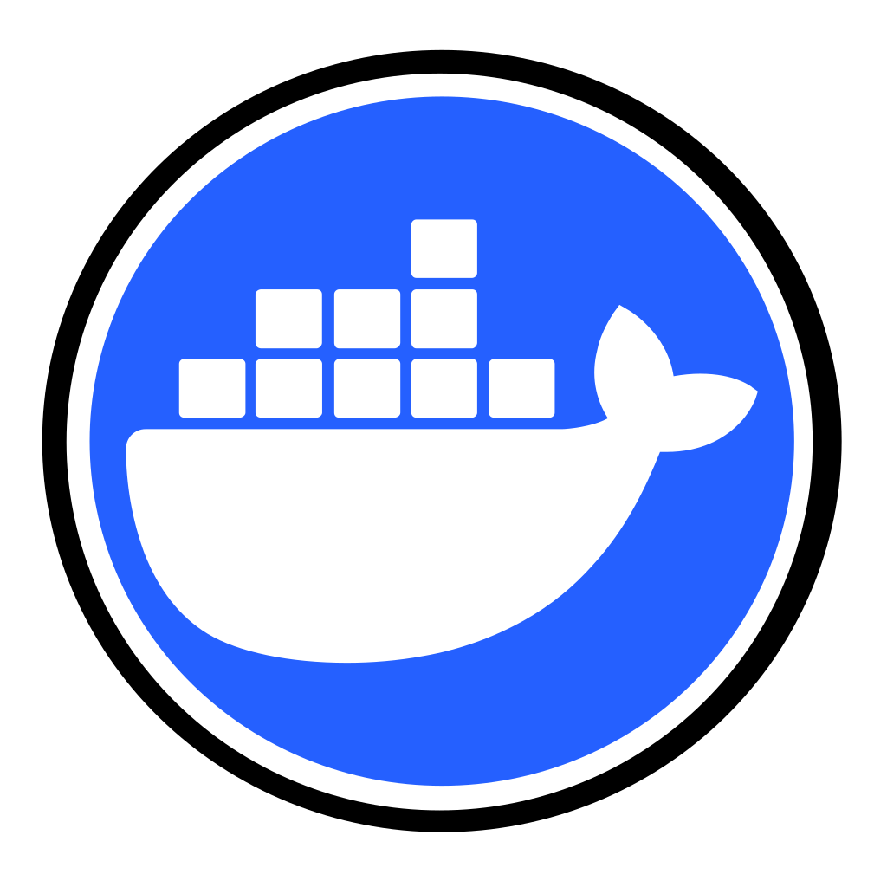
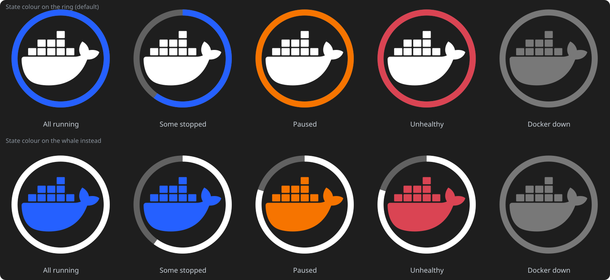

<div align="center">
  

  <h1 align="center">Dockmoid</h1>

  <p align="center"><strong>Docker and Podman in your KDE Plasma panel: live container status, crash alerts and one-click actions.</strong></p>

  <p align="center">
    <a href="https://kde.org/plasma-desktop/"></a>
    <a href="https://www.docker.com/"></a>
    <a href="https://podman.io/"></a>
  </p>

  <p align="center">
    <a href="https://doc.qt.io/qt-6/qmlapplications.html"></a>
    <a href="LICENSE"></a>
    <a href="CHANGELOG.md"></a>
  </p>

  <p align="center">
    <a href="#quick-start">Quick Start</a> | <a href="#what-it-does">What it does</a> | <a href="#monitoring-and-notifications">Monitoring</a> | <a href="#configuration">Configuration</a> | <a href="#keyboard">Keyboard</a> | <a href="#project-layout">Layout</a>
  </p>
</div>

---

##  Quick Start

```bash
git clone https://github.com/deathrashed/dockmoid
./dockmoid/install.sh     # installs the widget and its icon; run again to upgrade
```

Right-click the panel, choose **Add or Manage Widgets**, and add **Dockmoid**. It needs `docker`
(or `podman`) on your `PATH` and permission to use it.

> [!TIP]
> If the widget shows "You are not allowed to use Docker", run
> `sudo usermod -aG docker $USER`, then log out and back in. The widget offers to copy that command.

<table>
  <tr>
    <td align="center">
      
      <br>
      <strong>The panel logo is the dashboard.</strong> Top row: state colour on the ring (default). Bottom row: on the whale instead.
    </td>
  </tr>
</table>

##  What it does

| Area | Details |
| --- | --- |
| **Panel** | Gauge ring and running/total badge or dot. Blue while things run normally, amber paused, red unhealthy, crashed or restarting (those fill the whole ring), dim when Docker is down. The state colour can go on the ring or on the whale. Middle click is configurable. |
| **Views** | List with four levels of detail, a sortable table, or grouped by Compose project. Search, sort, pin to top, and a "needs attention" filter. |
| **Container actions** | Start, stop, restart, pause, kill, remove, rename, pull, update and recreate, follow logs in a terminal, copy name, id or image, open published ports in the browser. |
| **Compose projects** | Up, down, pull, pull and recreate, force recreate, for the whole project, plus start, stop and restart. Edit the compose file. |
| **Autostart** | See which containers Docker restarts after a reboot, and change the restart policy from the menu or the detail page. |
| **Logs** | In the popup with a line filter, errors-only, follow the newest line, wrap and copy. A "Run" tab executes a one-off command in a container. |
| **Graphs** | CPU and memory history per container, plus engine totals in the status bar. |
| **Resources** | Images, volumes and networks with "unused" markers, sizes, removal, and a clean-up dialog that estimates what you reclaim. |
| **Hosts** | Switch between Docker contexts, so the same widget can watch a server over SSH. |
| **Icons** | About 120 real service logos ship with it. One button downloads the full selfh.st set (about 3,000). |

##  Monitoring and notifications

Everything here is off until you turn on notifications, and the first poll after startup never notifies.
Each kind is its own event in **System Settings, Notifications, Dockmoid**, so each can have its own
sound or be silenced there.

| Event | Triggers when | Default |
| --- | --- | --- |
| Crash | A container exits with an error code (a clean stop, Ctrl+C or SIGTERM is not a crash) | on |
| Restart loop | A container starts restarting | on |
| Unhealthy / recovered | A healthcheck fails, or passes again | on / off |
| High resource use | CPU or memory stays above your limit for a set time, once per episode | 90% for 120 s |
| Web page down | A probed address stops answering, even though the container still runs | on |
| Image update | A registry has a newer digest for an image you run | on, if checks are enabled |
| Engine | Docker itself starts or stops | on |

Actions you start from the widget are muted for a short while, so pressing Stop does not notify you
about the stop.

<details>
<summary><strong>Web page probes and image update checks</strong></summary>

**Probes.** On *Monitoring*, list one `container-name=address` per line, or put a label on the
container:

```yaml
labels:
  dockmoid.probe: "http://localhost:8096/health"
```

A container turns red in the list when its page stops answering and counts toward the panel alert.

**Image updates.** Off by default, because it contacts registries. It compares each image's local digest
with the registry's, one image at a time and without downloading anything, every few hours. It needs
`docker buildx`. Images built locally, or shown only as an id, are skipped. "Update" in the container menu
pulls and recreates it (Compose containers; a plain `docker run` container can only be pulled).

</details>

##  Configuration

Everything works with defaults on a systemd and Docker machine. Settings are grouped into General,
Display, Monitoring, Notifications, Network, Integration, Icons, and Engine and commands.

| Setting | Default | Notes |
| --- | --- | --- |
| Change check | every 3 s open, 15 s closed | One tiny `events` query; the list is re-read only when it reports something |
| Full refresh | every 60 s | Safety net, and the only schedule if your engine has no `events` |
| Terminal | first one found | Konsole, GNOME Terminal, Kitty, Alacritty, Foot, WezTerm, Ghostty, XFCE Terminal, xterm |
| Editor | first one found | Kate, gedit, VS Code, then `xdg-open` |
| LAN and Tailscale address | detected | Used for "open in browser" links; only TCP ports are offered |
| Engine | `docker` | Presets for Docker, rootless Docker, Podman and Colima |
| Icons | about 120 bundled | *Configure, Icons* downloads the full set with `git` |

<details>
<summary><strong>Command templates, launchers and other engines</strong></summary>

Every command is editable and starts with `{engine}`, so changing the engine once changes them all.
Placeholders: `{engine}`, `{id}`, `{name}`, `{image}`, `{project}`, `{file}`, `{dir}`, `{shell}`, `{tail}`,
`{policy}`. Values that can contain text (`{name}`, `{image}`, `{file}`, `{dir}`) are shell-quoted for you,
so do not wrap them in quotes.

The **Open in** menu is one launcher per line under *Integration*:

```text
Label | icon name | scope | command
Konsole|konsole|container|konsole -e {engine} exec -it {id} {shell}
VS Code|code|project|code {dir}
```

`container` launchers need a running container; `project` launchers need a Compose folder. A launcher
whose program is not installed is hidden. Icon names are standard theme names, so every icon theme works.

**Podman** is supported on a best-effort basis (`podman ps --format json` returns an array, which is
handled). **Remote hosts** are Docker contexts: `docker context create srv --docker host=ssh://user@server`,
then pick it under the toolbar's more menu. Published ports then link to that server's address.

</details>

##  Keyboard

| Keys | Action |
| --- | --- |
| `Ctrl+F` | Focus the search box |
| `Esc` | Clear the search, then go back a page |
| `Ctrl+R` or `F5` | Refresh now |
| `Ctrl+1`, `Ctrl+2`, `Ctrl+3` | List, table, Compose groups |
| `Ctrl+Shift+A` | Show only containers that need attention |

The widget's global shortcut (open the popup from anywhere) is set under *Configure, Keyboard Shortcuts*.

##  Project layout

```text
dockmoid.plasmoid/
├── metadata.json                 # Plasma package metadata
├── install.sh                    # Installs the widget and its theme icon
├── contents/
│   ├── config/                   # Settings schema (main.xml) and page list
│   ├── lib/
│   │   ├── parsers.js            # Pure logic: parsing, state diffs, alerts, links
│   │   └── icons.js              # Pure logic: matching a container to an icon
│   ├── ui/
│   │   ├── main.qml              # Timers, notifications, representations
│   │   ├── Compact.qml           # The panel mark and its gauge
│   │   ├── Backend/              # Command runner and the Docker backend
│   │   ├── Views/                # Popup, detail, resources, output pages
│   │   ├── components/           # Rows, table, menus, dialogs, graphs, logs
│   │   └── config/               # The settings pages
│   ├── assets/                   # Panel mark layers and the bundled icon library
│   └── icons/                    # Package icon for Add Widgets
├── docs/assets/                  # README artwork
├── tests/                        # Node tests, qmllint wrapper, run.sh
├── translate/  po/               # Translation scaffold
└── packaging/                    # AppStream metadata
```

##  Development

```bash
tests/run.sh                    # parser, icon-matching and alert tests, XML check, qmllint
translate/extract.sh            # refresh po/template.pot from every i18n() call
```

The logic worth testing lives in `contents/lib/*.js` and has no QML dependency, so the tests run on plain
Node. To try the widget without touching your Plasma setup:

```bash
export XDG_DATA_HOME=/tmp/dockmoid-xdg
kpackagetool6 -t Plasma/Applet -i .
plasmawindowed dockmoid.plasmoid
```

<details>
<summary><strong>Troubleshooting</strong></summary>

| Symptom | Fix |
| --- | --- |
| "You are not allowed to use Docker" | `sudo usermod -aG docker $USER`, then log out and in |
| "The container command was not found" | Install Docker, or set the engine command under *Engine and commands* |
| Widget icon shows a question mark | Run `install.sh`, then reopen Add Widgets (the icon must be in an icon theme) |
| No notifications | Turn them on under *Notifications*; the first poll after startup is silent by design |
| No logos | Open *Configure, Icons* and download the set, or point it at your own folder |

Log every command the widget runs with *General, Troubleshooting*, then read it with
`journalctl --user -f | grep runner`.

</details>

##  License

<div align="center">

[**GNU GPL v3.0 or later**](LICENSE)

Dockmoid is a fork of [dockercompanion](https://github.com/bouteillerAlan/dockercompanion) by Bouteiller Alan (a2n)
and keeps its license.

Service logos are from [selfh.st/icons](https://github.com/selfhst/icons) under
[CC BY 4.0](https://creativecommons.org/licenses/by/4.0/) (see [the notice](contents/assets/library/NOTICE.md)).
The logos are trademarks of their owners.

**Copyright 2026 deathrashed**

</div>
