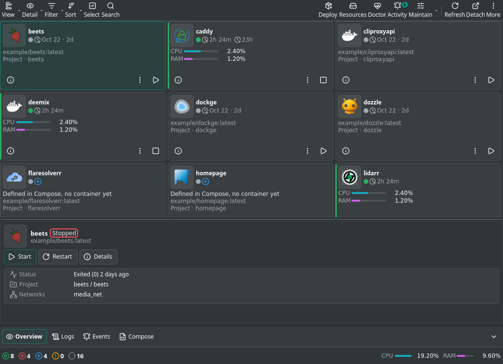
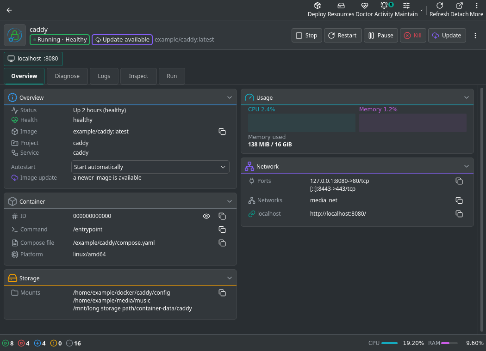
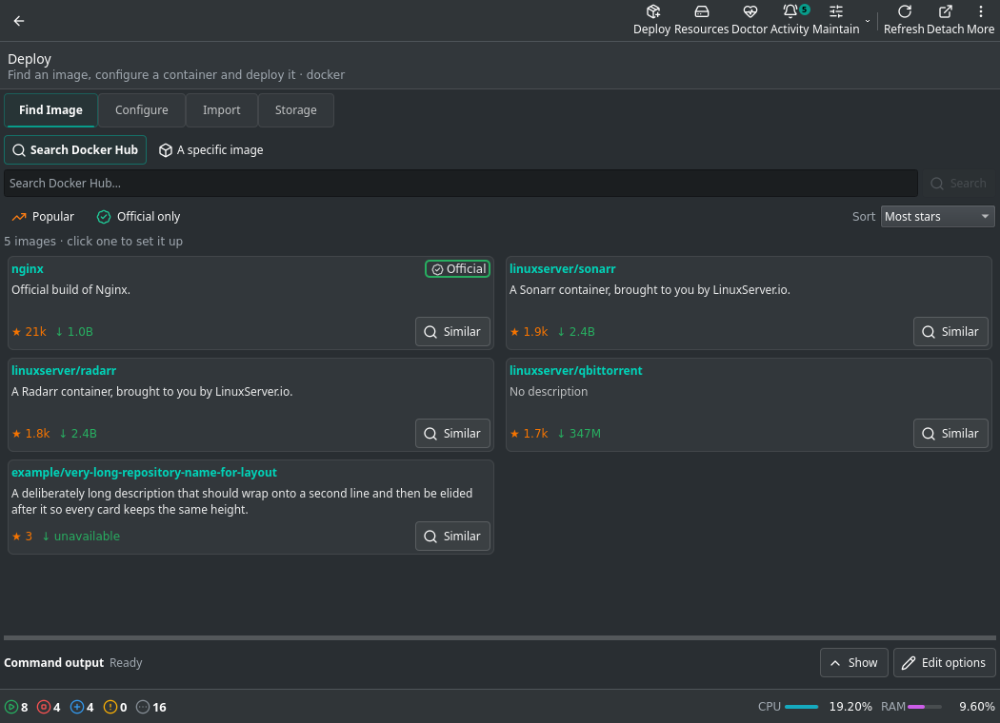
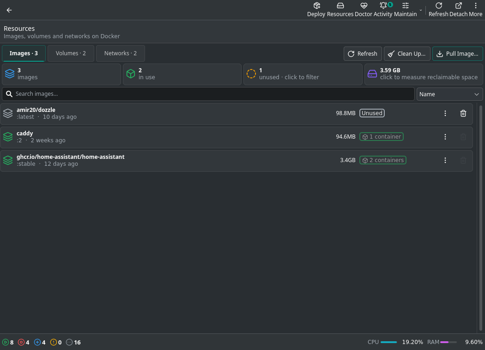
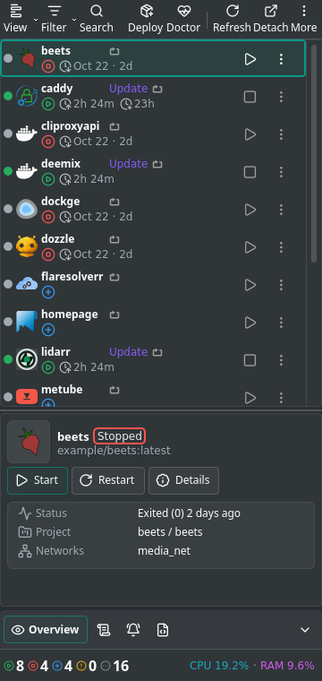

<div align="center">
<p align="center"></p>
<p align="center">
<picture>
<source media="(prefers-color-scheme: dark)" srcset="https://shieldcn.dev/header/graph.svg?title=DOCKMOID&subtitle=Your+containers.+In+your+panel.&mode=dark&align=center&logo=docker&logoColor=2560ff&theme=blue&height=160&border=false" />

</picture>
</p>
<p align="center"><strong>Monitor containers, manage Compose services and diagnose problems from KDE Plasma.</strong></p>
<p align="center"><a href="https://kde.org/plasma-desktop/"><picture><source media="(prefers-color-scheme: dark)" srcset="https://shieldcn.dev/badge/Plasma%206.svg?variant=secondary&size=sm&logo=kdeplasma&mode=dark&theme=blue&logoColor=ffffff" /></picture></a><a href="https://docs.docker.com/"><picture><source media="(prefers-color-scheme: dark)" srcset="https://shieldcn.dev/badge/Docker.svg?variant=secondary&size=sm&logo=docker&mode=dark&theme=blue&logoColor=ffffff" /></picture></a><a href="https://podman.io/"><picture><source media="(prefers-color-scheme: dark)" srcset="https://shieldcn.dev/badge/Podman.svg?variant=secondary&size=sm&logo=podman&mode=dark&theme=blue&logoColor=ffffff" /></picture></a></p>
<p align="center"><a href="#quick-start">Quick start</a> | <a href="#features">Features</a> | <a href="#screenshots">Screenshots</a> | <a href="docs/USER_GUIDE.md">Guide</a> | <a href="CHANGELOG.md">Changelog</a> | <a href="#license">License</a></p>
</div>


##  Quick Start

KDE Plasma 6 and an accessible Docker or Podman CLI are required. Python 3 and Docker Compose
are needed for Compose discovery/recreation; Python 3 is also needed for Docker Hub search.
Tested on Plasma 6.7.5. Older Plasma 6 versions have not all been exercised.

```sh
git clone https://github.com/deathrashed/dockmoid.git
cd dockmoid
./install.sh
```

Add **Dockmoid** through Plasma's widget browser, or enable it in **System Tray Settings → Entries**.
Choose the engine and connection in Dockmoid Settings, then run **Test connection**.
The installer updates only the current user's package and restores the previous package if installation fails.

<details>
<summary><strong>Install or update a downloaded package</strong></summary>

Download the `.plasmoid` file from the project's release assets when available.

```sh
# First installation
kpackagetool6 -t Plasma/Applet -i dockmoid-2.4.0.plasmoid
# Update an existing installation
kpackagetool6 -t Plasma/Applet -u dockmoid-2.4.0.plasmoid
```

For KDE Store publication, the same `.plasmoid` is the upload package. A Store listing is not yet
linked here because its public URL has not been assigned. Remove Dockmoid using Plasma's widget tools.

</details>

##  Features

| Workflow | Available controls |
| --- | --- |
| Containers | List, Table, Grid and Groups; Minimal, Normal, Detailed and Verbose information; collapsible state sections |
| Inspector | A dock under the list for the selected container: Overview, live Logs, Events and its Compose file |
| Actions | Start, Stop, Restart, Pause, Kill, Update and Apply Compose Changes everywhere, with one set of rules and a reason when greyed out |
| Details | Overview, usage graphs, ports, networks, mounts, logs, Inspect Tree/Raw and a Run tab |
| Deploy | Docker Hub search with star/download counts, an Official filter, guided Compose deployment and import |
| Resources | Images, volumes and networks, with what uses each one, cleanup and image pulls |
| Diagnosis | Doctor insights and checks, a Diagnose tab per container with a log digest, background log watch, network comparison, merged logs and a redacted problem report |
| Bulk actions | Select Several, then review exactly which containers Start/Stop/Restart/Update apply to |
| Monitoring | Health and crash alerts, resource thresholds, web probes, an Activity log and event-driven refresh |
| Desktop | Panel and system tray, a detachable window, saved views and settings shared between widgets |

Compose discovery keeps configured services visible as **Undeployed** (Pending Deployment) when their
containers have been removed. **Start** starts an existing container; **Create and start** creates only
the chosen service. Nothing starts every configured service automatically.

##  Screenshots

These previews render the production QML with demonstration records, without exposing a personal host.


<details>
<summary><strong>Grid, details, deployment, resources and a narrow tray popup</strong></summary>









<p align="center"></p>

</details>

##  Configure

Pick the view and detail level from **View** and **Detail** in the toolbar. Filter, Sort and Select sit
beside them. Search, the inspector's tabs (including Health) and Home sit on the strip under the list; drag the divider to size the inspector, or collapse it. Sizes,
collapsed sections and the inspector tab are saved per view. Right-click a container for every action,
its links and its Compose project. At narrow widths, toolbar actions move into **More**.

In **Settings**, configure the connection, panel appearance, storage paths, monitoring and command
presets. See the [user guide](docs/USER_GUIDE.md) for cleanup choices, logs, connection troubleshooting
and refresh behavior.

> [!NOTE]
> Cleanup preserves stopped containers and volumes by default. Removing stopped containers is an
> explicit choice. Docker access and customized shell commands carry the permissions of your account.

##  Compatibility

- Docker supports local Compose discovery and guided deployments. Discovery skips `_archive`, `_backups`,
  `startup`, hidden directories, `.git` and `node_modules`; it is not a recursive backup/config importer.
- Podman supports container listing, stats, events, logs, inspect, direct controls, pull and read-only
  image/volume/network inventories. Compose, registry digest checks, restart-policy editing, full disk
  summaries and system-service controls are not enabled for Podman.
- With a remote engine (SSH or TCP), Compose files are not read or edited locally: their paths name
  files on the remote host.
- Metrics depend on engine output; unavailable metrics are not evidence of zero usage.
- Image search sorts the first 50 returned Docker Hub results. Popular is not a global ranking, and
  Similar searches by repository name. Docker Hub requires an internet connection.
- Doctor uses **Plan only** where the engine has no dry-run operation. A command preview cannot
  guarantee the outcome; inspect the selected actions before execution.
- No low-memory or measured before/after performance guarantee is made. Background statistics are
  optional, expensive reads are gated, and diagnostic/resource pages reuse short-lived cached results.

##  Development

```text
contents/
  ui/          # Plasma views, settings and backend components
  lib/         # Parsing, commands and presentation helpers
  scripts/     # Standard-library Python discovery and registry helpers
  assets/      # Bundled interface and service artwork, with licenses
tests/         # Isolated regression and packaging checks
docs/          # User guide, screenshots and Store submission text
translate/     # Translation template extraction and build
packaging/     # AppStream metadata and package manifest
```

Read [CONTRIBUTING.md](CONTRIBUTING.md) for prerequisites and checks, [SECURITY.md](SECURITY.md)
for reporting guidance, and [RELEASE_CHECKLIST.md](RELEASE_CHECKLIST.md) for packaging and upload steps.
[CHANGELOG.md](CHANGELOG.md) lists changes since the [2.4.0 release notes](docs/RELEASE_NOTES.md).

Bundled artwork licenses and historical attribution are in [THIRD_PARTY_NOTICES.md](THIRD_PARTY_NOTICES.md).

## <a href="https://opensource.org/license/GPL-3.0"></a> License

<div align="center">

[**𝗚𝗣𝗟 𝗟𝗜𝗖𝗘𝗡𝗦𝗘**](LICENSE)

<a href="LICENSE"></a>

**𝗖𝗢𝗣𝗬𝗥𝗜𝗚𝗛𝗧 © 𝟮𝟬𝟮𝟲 𝗗𝗘𝗔𝗧𝗛𝗥𝗔𝗦𝗛𝗘𝗗**

</div>
